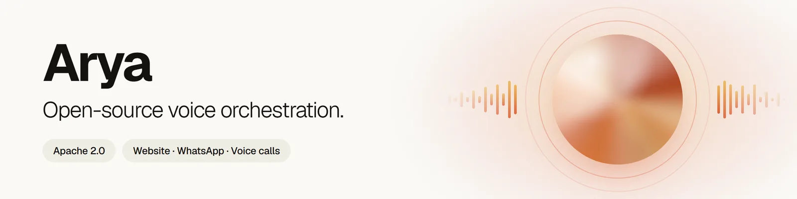
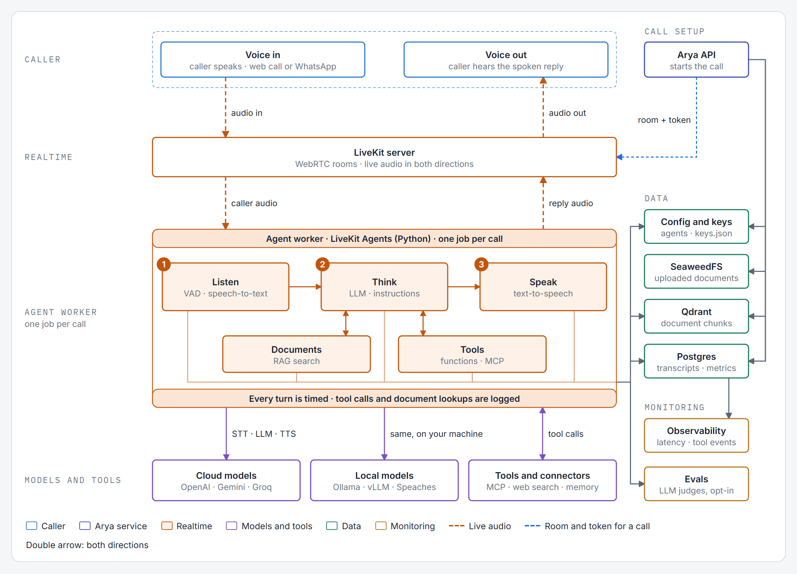
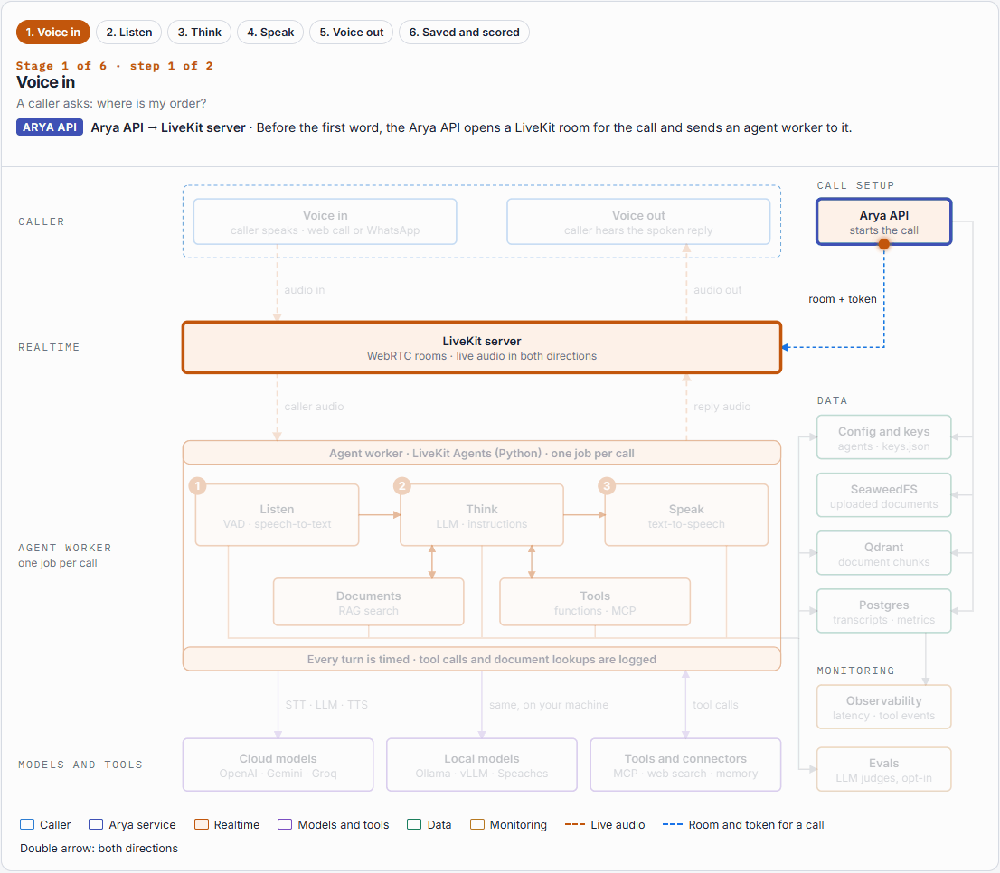

<p align="center">
  <a href="https://traversaal.ai/arya">
    <picture>
      <source media="(prefers-reduced-motion: reduce) and (prefers-color-scheme: dark)" srcset="docs/media/banner-dark.png">
      <source media="(prefers-reduced-motion: reduce)" srcset="docs/media/banner-light.png">
      <source media="(prefers-color-scheme: dark)" srcset="docs/media/banner-dark.webp">
      <source media="(prefers-color-scheme: light)" srcset="docs/media/banner-light.webp">
      
    </picture>
  </a>
</p>

<p align="center">
  <b>Open-source AI voice agents for customer support.<br>
  Put one on your website, on WhatsApp, and on live voice calls, all set up from a browser.</b>
</p>

<p align="center">
  
  
  
  <a href="https://livekit.io"></a>
</p>

<p align="center">
  <a href="#what-you-can-build">Use cases</a> ·
  <a href="#features">Features</a> ·
  <a href="#quickstart">Quickstart</a> ·
  <a href="#architecture">Architecture</a> ·
  <a href="#documentation">Documentation</a> ·
  <a href="docs/DEPLOYMENT.md">Deployment</a> ·
  <a href="docs/TROUBLESHOOTING.md">Troubleshooting</a>
</p>

Arya is an open-source voice-agent starter kit built on [LiveKit](https://livekit.io).
You run one command, open a page in your browser, answer a few questions,
and you're **talking to your own AI voice agent**. No coding needed. All the
setup (API keys, documents, abilities) happens in the browser UI.

## What you can build

One agent, built once in the browser, answers your customers on every
channel with the same knowledge base, tools and connectors.

| Use case | What your customers get | Guide |
|---|---|---|
| **Website assistant** | A voice and chat bubble on any page of your site, added with one line of HTML. Answers come from your documents and cite their sources. | [Agent integration](docs/AGENT-INTEGRATION.md) |
| **WhatsApp support line** | Your agent answers on your WhatsApp number: typed messages, photos and voice notes, with spoken replies and tappable option lists. | [Channels](docs/CHANNELS.md) |
| **Voice calls for customer support** | A live, interruptible voice call with your agent from any desktop or phone browser, through a share link or the website widget. Every call is transcribed and measured. | [Deployment](docs/DEPLOYMENT.md) |

Typical support jobs ship as ready-made templates: help desk, order and
returns, reservations, patient scheduling, ticketing, client intake,
admissions, travel planning, and more.

> **Scope of voice calls today:** calls run over the web (WebRTC). Dial-in
> through a telephone number and live WhatsApp voice calls are not wired up
> yet.

## Features

- **Voice and text in one session**: real-time voice **and** text chat with the same agent; you can interrupt it mid-sentence.
- **Four providers to pick from**: **OpenAI** (one key), **Gemini** (one key, Google ears/brain/voice), **Groq** (open models, hosted free tier, one key), or **fully local** (Whisper + Qwen + Kokoro via Ollama, no key at all, or point it at your own **vLLM** server).
- **Answers from your documents**: upload PDFs/Word/text documents; the agent answers from them and cites the source.
- **Live web search**: current info such as prices, news and opening hours.
- **Memory**: the agent remembers you between calls (optional, switch on under Advanced settings; remembers each visitor per browser, and a Visitors screen shows or forgets what it knows).
- **Connectors**: let the agent act on real systems mid-call: Cal.com booking, Google Calendar, your own Postgres database (read-only), Composio, or any MCP server. See [docs/CONNECTORS.md](docs/CONNECTORS.md).
- **Eleven ready-made templates**: one per industry (travel planning, reservations, order & returns, scheduling, intake, help desk, ticketing, admissions, and more).
- **Metrics and evals built in**: every call is timed and transcribed, with optional AI-judged quality checks. See [docs/METRICS.md](docs/METRICS.md).
- **Runs entirely on your own machine**: the only cloud spend is your own API keys (or none).

> **Extending the kit with an AI coding assistant** (Claude Code, Cursor…)?
> Point it at [agents.md](agents.md); it maps the repo and the extension points.

---

## Requirements

Docker downloads everything for you, which is convenient, but it isn't
small. **Check your free disk space before you start**; running out
mid-download is the most common first-run failure (and on a Mac it can
also trigger a scary "your system has run out of application memory"
dialog, because macOS keeps its swap file on the same full disk).

| | Free disk | RAM for Docker |
|---|---|---|
| **OpenAI or Groq** (recommended start) | **10 GB** | 4 GB |
| **Everything, including the local models** | **25 GB** | 8–10 GB |

Also needed: **Windows 10/11** with WSL2 (installed in step 2 of the next
section: Docker Desktop runs on top of it), or a **Mac** (Apple Silicon or
Intel) on a macOS version from the last ~3 years, or any Linux with
Docker Engine. No GPU required anywhere. Note that on Mac and
Windows, Docker can't use your GPU for the local models regardless, so
they run on CPU.

**Tight on disk?** If you're using OpenAI or Groq, you don't need the three
local-model services at all, which takes the download from ~18 GB to ~6 GB.
Step 3 of the quickstart has that command; you can add them any time later.

---

## Before you start

Three things, 10 to 15 minutes, one time only.

### 1. An API key: OpenAI, Groq, or Gemini

You bring your own key; it stays on your machine and is pasted into the
browser UI later.

**OpenAI (best quality):** go to <https://platform.openai.com/api-keys>,
sign in, click **"Create new secret key"**, and copy it (`sk-...`). New
accounts need a small credit balance (Settings → Billing); five dollars
is plenty to play with.

**Groq (free, open models):** go to <https://console.groq.com/keys>,
sign up, and create a key. Groq runs open models (Llama, Whisper) on a
generous free tier, very fast.

**Gemini (one key, Google):** go to <https://aistudio.google.com/apikey>,
sign in, and create a key. One key covers transcription, the brain and the
voice; the Gemini voices are the most expressive of the hosted options.

**No key?** The key-less option, **"Open source"** (fully on your machine),
runs Whisper + Llama + Kokoro locally via **Ollama** (or point it at your
own **vLLM** server instead; see [agents.md](agents.md)): free, private,
key-less, works offline. It's also by far the most demanding: budget
**~8 GB of RAM and ~25 GB of disk** (see the table above; the local
`ollama` + `speaches` services alone are ~11 GB of downloads). On Windows,
WSL only gets half your RAM by default; if you have
16 GB or more, create `C:\Users\<you>\.wslconfig` containing:

```ini
[wsl2]
memory=11GB
```

then run `wsl --shutdown` in PowerShell and restart Docker Desktop.
Without this, the local models swap to disk and time out.

### 2. Docker Desktop

Docker runs all the moving parts for you, so you don't have to install
anything else: no Python, no Node, nothing.

**Windows:**
1. Open **PowerShell as Administrator** and run:
   ```powershell
   wsl --install -d Ubuntu
   ```
   then **restart your computer** when it asks. (This installs WSL2,
   the Linux layer Docker on Windows runs on. If you already use WSL, skip this.)
2. Download and install **[Docker Desktop](https://www.docker.com/products/docker-desktop/)**.
   During setup, keep the default **"Use WSL 2"** option checked. This one is
   required, not a preference: the voice agent needs host networking (see #3
   below), which only exists on the WSL 2 engine. On the older Hyper-V
   backend, calls connect and the agent stays silent.
3. Start Docker Desktop and wait until the whale icon in the taskbar stops animating.

**Mac:** install [Docker Desktop](https://www.docker.com/products/docker-desktop/), open it once.

**Linux:** any recent Docker Engine with the compose plugin works.

### 3. One Docker setting (Windows & Mac)

Open Docker Desktop → **Settings (gear icon) → Resources → Network** →
turn **ON** “**Enable host networking**” → **Apply & restart**.

*(Why: the voice agent needs a direct line to the audio server for live
sound. Without this switch it connects but stays silent. Linux users skip
this; it's already how Docker works there.)*

---

## Quickstart

Six steps from a fresh clone to talking with your agent.

### Step 1: Get the code

If you have git, open a terminal (on Windows the **Ubuntu** one, see the note
below) and run:

```bash
git clone https://github.com/traversaal-ai/arya_.git arya
cd arya
```

No git? Click **Code → Download ZIP** on the GitHub page, unzip it, then open
a terminal in that folder. On Windows that terminal must be Ubuntu or Git
Bash, never `cmd`: step 2 runs a shell script.

<details>
<summary><b>Windows: clone it inside WSL, not on <code>C:</code> or <code>D:</code> (click to expand)</b></summary>

Open the **Ubuntu** terminal (it came with the `wsl --install` above) and
clone into your Linux home, e.g. `~/projects/arya`; run every
`docker compose` command from that same terminal. For `docker` to exist in
there, turn on Docker Desktop → **Settings → Resources → WSL Integration**
for your distro (that switch only adds the CLI to Ubuntu; it is not the
engine, which is the "Use WSL 2" option above and is already on). Explorer
can still browse it at `\\wsl$\Ubuntu\home\<you>\projects\arya`, and
VS Code opens it with the WSL extension.

A Windows-side clone does run, but the folder holding your API keys and
engine admin tokens (`backend/data`) then sits on a mount that ignores file
permissions, so its owner-only protection stops applying; it's also slower,
and `./scripts/init.sh` needs a WSL or Git Bash shell either way (`cmd`
can't run it). If you go that route, set
`git config --global core.autocrlf input` **before** cloning, or the script
fails with a `bad interpreter` error.

</details>

### Step 2: Generate your local secrets (once)

```bash
./scripts/init.sh
```

The repo ships no passwords or signing keys (it's public; anything
committed here would be everyone's). This writes them for your machine
into gitignored files (`.env`, `livekit.yaml`, `seaweedfs-s3.json`,
`backend/.env.local`) and never overwrites existing ones. On Windows, run
it from the WSL/Git-Bash terminal you'll run Docker from.

### Step 3: Start everything

```bash
docker compose up --build
```

**This first run downloads ~18 GB**, so budget **10 minutes on a fast
office connection and 30 to 45 on a typical home one**. It builds everything
once. You'll see a lot of text scrolling; that's normal. It's ready when the
scrolling settles down and the API prints `Arya is ready` with the URL
to open. Leave this window open. (Every later start is just
`docker compose up`, and takes seconds.)

**Using OpenAI or Groq?** Then you don't need the three local-model services
(`ollama`, `speaches` and their model pullers), which is ~12 GB of that
download. Start only what you need instead:

```bash
docker compose up --build api agent-worker livekit postgres qdrant seaweedfs
```

Add them whenever you want the fully-local provider, or free local
embeddings for document search:

```bash
docker compose up -d ollama ollama-init speaches speaches-init
```

Skipping them is safe: the app reaches those services over the network and
simply reports them as unavailable when they aren't running.

### Step 4: Open the app

Go to **<http://localhost:8000>** in Chrome or Edge. Type that address
yourself: the terminal prints `http://0.0.0.0:8000`, which is the server
saying "listening on every address" and is **not** something a browser can
open. Same port, use `localhost`. You should see the Arya home page. (If the
backend isn't up yet a warning note says so; give the build a minute and
reload.)

### Step 5: Create your agent

Click **Create a new voice agent**, then either **Build agent from scratch**
(pick your industry, name your business, state the goal; the prompt is
generated for you) or pick a template for your industry (each one asks you
to name your business and your agent before it can be saved). The next
screen asks for just three things: the agent's name, your business name, and
your provider (OpenAI, Gemini, Groq, or fully local) with its **key** from
earlier if one is needed. That is enough to talk to it. Documents, web
search, memory, connectors, the model and voice pickers, and the generated
system prompt all sit under **Advanced settings** on the same screen,
collapsed and off by default; open it whenever you want them. The UI guides
you from here.

### Step 6: Talk to it

On the review screen press **▶ Test agent**, then press the **green call
button**; the call only starts when you do. Allow the microphone when the
browser asks, and say hello. You can also type in the chat box: same agent,
same conversation. Press the **red hang-up button** when done, and
**Call again** whenever you like.

**To shut everything down:** press `Ctrl+C` in the terminal, or run
`docker compose down`. Your agent, keys, and documents are saved and will
be there next time.

**Next:** put the agent in front of customers. Embed it on a website with
[docs/AGENT-INTEGRATION.md](docs/AGENT-INTEGRATION.md), connect a WhatsApp
number with [docs/CHANNELS.md](docs/CHANNELS.md), or host it publicly with
[docs/DEPLOYMENT.md](docs/DEPLOYMENT.md).

---

## Configuration

### Where do my keys go?

Keys you paste in the UI are saved to **`backend/data/keys.json`** on your
machine (this folder is gitignored; it can never end up in a repo). The
agent reads that file at the start of every call, which is why a key you
add in the UI works immediately: no restart, no `.env` editing, no
environment variables to set.

Developers who prefer env vars can export `OPENAI_API_KEY`,
`GROQ_API_KEY`, `GOOGLE_API_KEY` (Gemini), `SERPAPI_API_KEY`, or
`MEM0_API_KEY` instead; they're used as fallbacks when the UI hasn't stored
a key.

Infrastructure settings (ports, passwords, public URLs) live in `.env`,
which `./scripts/init.sh` generates. [.env.example](.env.example) documents
the variables.

---

## Architecture

Arya is one Docker image run as a few small services around a LiveKit
server. The browser talks to the Arya API over HTTPS to set up a call, then
audio flows directly between the browser and LiveKit. Nothing in the audio
path goes through the API. WhatsApp follows the same path: the bridge
receives Meta's webhook, starts a session through the public API, and relays
text through the room.

<p align="center">
  <picture>
    <source media="(prefers-color-scheme: dark)" srcset="docs/media/architecture-dark.png">
    <source media="(prefers-color-scheme: light)" srcset="docs/media/architecture-light.png">
    
  </picture>
</p>

<p align="center"><sub>Dashed orange lines are live audio. The dashed blue line is the Arya API creating the room and token for a call.</sub></p>

### How a call works

<p align="center">
  <picture>
    <source media="(prefers-color-scheme: dark)" srcset="docs/media/architecture-dark.gif">
    <source media="(prefers-color-scheme: light)" srcset="docs/media/architecture-light.gif">
    
  </picture>
</p>

<p align="center"><sub>A 35-second walkthrough of one call in six stages: voice in, listen, think, speak, voice out, and saved and scored. Source pages, which you can open in a browser to step through it yourself: <a href="docs/media/architecture-light.html">light</a>, <a href="docs/media/architecture-dark.html">dark</a>.</sub></p>

### What's in the box

| Service (docker) | Role | Port |
|---|---|---|
| `livekit` | Real-time audio server (WebRTC) | 7880, 7881 (+50000–50100/udp) |
| `api` | Backend + this UI | **8000** |
| `agent-worker` | The voice agent itself (LiveKit Agents, Python) | (none) |
| `arya-mcp` | Arya's own MCP servers (the read-only Postgres connector) | 8020 (localhost only) |
| `arya-whatsapp` | WhatsApp channel bridge: Meta's webhook in, a LiveKit room out | 8030 (localhost only) |
| `postgres` | Conversations, transcripts, ingest queue | 5432 |
| `qdrant` | Vector store for document search (RAG) | 6333 |
| `seaweedfs` | Storage for uploaded documents | 8333, 8888 (browse them) |
| `ollama` | Local embeddings + open-source chat model (Llama), the Ollama backend | 11434 |
| `speaches` | Local speech-to-text (Whisper) **and** text-to-speech (Kokoro) for the open-source provider | 8010 |

### The voice pipeline

The pipeline is **cascaded**: speech-to-text → LLM → text-to-speech as
separate, swappable stages, with local voice activity detection and turn
detection. Four providers, chosen per agent in the UI. The table compares
three of them; **Gemini** is the fourth and runs all three stages on one
Google key.

| | OpenAI (default) | Groq (open models) | Open source (local) |
|---|---|---|---|
| Ears (STT) | selectable, default `gpt-4o-mini-transcribe`, **streaming** (transcribes while you speak) | Whisper large-v3-turbo (batch) | faster-whisper `base` (local, via Speaches, batch) |
| Brain (LLM) | selectable, default `gpt-4o-mini` | **GPT-OSS 120B** | Qwen3.5 2B via **Ollama** (Apache-2.0), or your own **vLLM** server |
| Voice (TTS) | selectable, default `gpt-4o-mini-tts` | Orpheus | Kokoro-82M (local, via Speaches) |
| Needs | OpenAI key (paid) | Groq key (**free tier**) | nothing; key-less & private |
| Feel | best quality | fast + smart, free | slowest; needs ~8 GB RAM |

The OpenAI column's STT, LLM, and TTS + voice are each a dropdown on the
abilities screen: a small curated set of current models, not one hardcoded
default (see `agents.md` → "Swap the OpenAI models" to add another).

Typed chat rides LiveKit's `lk.chat` text stream into the **same live
session**: same brain, tools, documents, and memory as voice.

<details>
<summary><b>The Open source provider has two backends: Ollama and vLLM (click to expand)</b></summary>

Both are picked on the abilities screen:

- **Ollama** overrides the brain (LLM) only; ears and voice always use
  the bundled Whisper/Kokoro (there's no usable speech route on Ollama
  itself). Leave its endpoint blank for the bundled container, or point it
  at your own Ollama server.
- **vLLM** can run ears, brain, and voice each on your own server, but
  vLLM serves **one model per process**, so a full pipeline needs
  separate `vllm serve` invocations per stage, and core vLLM has **no
  built-in voice model** (voice falls back to the bundled Speaches/Kokoro
  endpoint unless you point it elsewhere). Example:

  ```bash
  # vLLM's default port is 8000, the same port Arya's own API uses,
  # so run vLLM servers on other ports.
  vllm serve Qwen/Qwen3-4B-Instruct-2507 --port 8001        # brain (Apache-2.0, non-thinking)
  vllm serve openai/whisper-large-v3-turbo --port 8002      # ears (needs `pip install vllm[audio]`)
  ```

  A **Check** button next to each endpoint field asks the server what it
  actually serves (`GET /v1/models`), the fastest way to catch a typo'd
  URL or model id before starting a call.

</details>

---

## Troubleshooting

The first-run failures, with the fix in one line each. Every error we've
seen, with the full commands, lives in
**[docs/TROUBLESHOOTING.md](docs/TROUBLESHOOTING.md)**: search that page for
whatever your terminal printed.

| Symptom | Fix |
|---|---|
| “Can't reach the backend” warning in the UI | The stack isn't up or is still building; check `docker compose ps`, then reload. |
| The terminal only shows `http://0.0.0.0:8000` and it won't open | That's not an address you can visit; open **<http://localhost:8000>**. |
| Call connects but the agent never speaks | Almost always the **host networking** setting (see "Before you start" #3), then `docker compose down` and `up` again. |
| Browser never asks for the microphone | Use Chrome or Edge on `http://localhost:8000`; other hostnames need HTTPS. |
| “Before this agent can run: … key is missing” | Paste the key on the abilities screen; the review screen lists exactly what's missing. |
| Document stuck in `pending` | The first PDF downloads OCR models once, and scanned PDFs are slow. Give it a few minutes; `docker compose logs api`. |
| Build fails with `no space left on device` or `failed to extract layer …` | **Out of disk** (it usually dies on the 8 GB `ollama` image). Follow the [full steps](docs/TROUBLESHOOTING.md#build-fails-with-failed-to-extract-layer--input-output-error-or-no-space-left-on-device) (they start with a gentler fix than clearing images), or [start lean](#requirements). |
| `api` exits with `password authentication failed for user "arya"` | The `.env` password and the database volume disagree; delete **only** the `pg-data` volume. [Full steps](docs/TROUBLESHOOTING.md#postgres-password-authentication-failed); never `docker compose down -v`. |
| **Windows:** `ports are not available: exposing port UDP … forbidden by its access permissions` | Windows grabbed part of the `50000-50100` UDP range. `net stop winnat` then `net start winnat` as Administrator, then restart Docker Desktop. [Full steps](docs/TROUBLESHOOTING.md#windows-udp-port-range-blocked). |
| `livekit` or `seaweedfs` dies at startup, or an empty **folder** named `livekit.yaml` appeared | Its generated config went missing; re-run `./scripts/init.sh`, which reuses your existing keys. |
| A turn takes several seconds | On Groq or the local provider this is the known trade-off of batch speech-to-text. On OpenAI, STT streams by default; check that `OPENAI_STT_REALTIME` is not set to `0` and the agent's `stt.realtime` is not `false`. |

---

## Development

Optional; regular users never need this. Run the infrastructure in Docker
but the app code on your machine for fast iteration. Requires
[uv](https://docs.astral.sh/uv/) and Node 20+:

```bash
docker compose up livekit postgres qdrant seaweedfs ollama ollama-init   # infra only
```

```bash
cd backend && uv sync
uv run uvicorn api:app --app-dir src --port 8000 --reload    # terminal 1: API
```

```bash
cd backend
uv run python src/agent.py dev                               # terminal 2: agent worker
```

```bash
cd frontend
npm install && npm run dev                                   # terminal 3: UI → http://localhost:5173
```

The Vite dev server proxies `/api` to :8000. See [agents.md](agents.md) for
the repo map, config schema, and how to add tools, templates, or providers.

---

## Documentation

| Guide | What it covers |
|---|---|
| [docs/AGENT-INTEGRATION.md](docs/AGENT-INTEGRATION.md) | Embed a published agent on any website: the one-line script tag, styling, allowed origins. |
| [docs/CHANNELS.md](docs/CHANNELS.md) | Answer on WhatsApp: what Meta requires, connecting a number, photos, voice notes, costs. |
| [docs/CONNECTORS.md](docs/CONNECTORS.md) | Connect external tools: Cal.com, Google Calendar, Postgres, Composio, custom MCP servers. |
| [docs/DEPLOYMENT.md](docs/DEPLOYMENT.md) | Deploy an Arya engine on GCP and put your agent on the public internet (share link, embeddable widget, public call API). On AWS instead? Same guide, EC2 edition: [docs/DEPLOYMENT-AWS.md](docs/DEPLOYMENT-AWS.md). |
| [docs/METRICS.md](docs/METRICS.md) | Every number Arya records per call: latency, usage, behavior, and the AI-judged evals. |
| [docs/TROUBLESHOOTING.md](docs/TROUBLESHOOTING.md) | Every failure we've hit and the exact commands that fix it. |
| [docs/MODEL-LICENSES.md](docs/MODEL-LICENSES.md) | Licenses of the bundled and hosted models, and your responsibilities as a deployer. |
| [demo/README.md](demo/README.md) | A bundled demo page for testing the website widget. |
| [agents.md](agents.md) | Repo map, config schema, and extension points, for AI coding assistants and curious humans. |

---

## Security

This is a **local, single-user developer tool**: no login, and provider keys
are stored in plaintext in `backend/data/keys.json` (gitignored). Don't
expose port 8000 to the internet as-is; [docs/DEPLOYMENT.md](docs/DEPLOYMENT.md)
covers what to change before you do.

## Contributing

Issues and pull requests are welcome. Before changing code, read
[agents.md](agents.md): it maps the repo, lists the extension points, and
ends with how to verify a change.

## License

[Apache-2.0](LICENSE): use it, fork it, ship it. Model and provider licenses
are separate; see [docs/MODEL-LICENSES.md](docs/MODEL-LICENSES.md).
